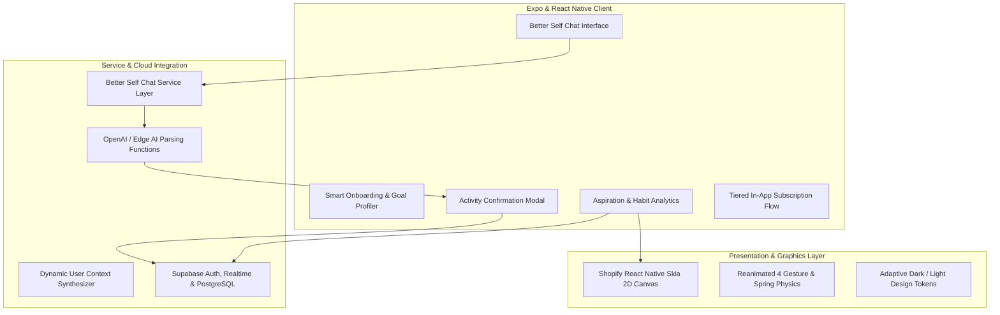

# 🌿 Kyvo — AI-Powered Wellness & Habit Companion

> **Cross-Platform AI Wellness & Habit Tracking Mobile Platform** built with **Expo SDK 54, React Native 0.81, TypeScript, Supabase, and Shopify React Native Skia**, featuring real-time conversational activity extraction ("Better Self Chat"), automated goal logging, and subscription monetization.

[](https://expo.dev)
[](https://reactnative.dev)
[](https://www.typescriptlang.org)
[](https://supabase.com)
[](https://shopify.github.io/react-native-skia/)
[](https://docs.swmansion.com/react-native-reanimated/)

---

## 📌 Executive Summary

**Kyvo** is a personal wellness companion application engineered to bridge the gap between unstructured daily thoughts and structured personal growth. At its core is **Better Self Chat**, an intelligent conversational interface backed by Edge AI that automatically detects, parses, and logs user habits, workouts, nutrition milestones, and emotional reflections directly into a normalized relational database.

Built on **Expo Router** and React 19, Kyvo features high-performance 2D graphics powered by **Shopify React Native Skia**, 60fps gesture-driven animations via **Reanimated 4**, and secure serverless state persistence via **Supabase**.

---

## 🏗️ System Architecture



---

## ✨ Key Features & Technical Highlights

### 1. 💬 Conversational Activity Extraction ("Better Self Chat")
- **Natural Language Parsing:** Chat conversationally about your day; the Edge function automatically extracts structured activity records (e.g., *"Completed 45m HIIT workout"* or *"Drank 2L water"*).
- **Confirmation Flow:** Dedicated `ActivityConfirmationDialog` allows instant verification and categorization before database insertion.
- **Context-Aware Prompts:** Dynamically injects recent aspiration history into the LLM context for hyper-personalized responses.

### 2. 🎨 High-Performance Visual Stage
- **Shopify React Native Skia:** Smooth interactive visual elements and custom data visualizations rendered directly on the GPU canvas.
- **Reanimated 4 Fluid Gestures:** Native driver springs, sheet transitions, and responsive keyboard layout adjustment.
- **Adaptive Appearance:** First-class light and dark mode design system matching device aesthetics.

### 3. 💳 In-App Subscription & Access Control
- Complete end-to-end subscription architecture with tiered paywalls, trial management, and receipt validation pipelines.
- Granular permission gating protecting premium AI conversational quotas.

### 4. 🗄️ Supabase Cloud Backend
- Row-Level Security (RLS) policies safeguarding private journals, aspirations, and activity logs.
- Real-time client synchronization keeping metrics up-to-date across multiple devices.

---

## 💻 Tech Stack & Dependencies

| Layer | Technologies |
| :--- | :--- |
| **Framework** | Expo SDK 54 / React Native 0.81 / React 19 |
| **Language** | TypeScript 5.9 (Strict Type Checking) |
| **Routing** | Expo Router (Typed File-System Navigation) |
| **Backend & Auth** | Supabase JavaScript Client (`@supabase/supabase-js`) |
| **2D Graphics & Canvas** | `@shopify/react-native-skia` |
| **Animation & Gestures** | `react-native-reanimated` (v4), `react-native-gesture-handler` |
| **Multimedia & Hardware** | `expo-camera`, `expo-av`, `expo-haptics`, `expo-image` |
| **Notifications** | `expo-notifications` (Local & Push Trigger Engine) |

---

## 📁 Project Structure

```
kyvo/
├── app/                              # Expo Router file-system routes
│   ├── (tabs)/                       # Bottom tab navigation screens
│   ├── lib/                          # Business logic & API services
│   │   ├── better-self-chat-service.ts
│   │   └── better-self-context.ts
│   └── screens/                      # Domain feature screens
│       └── better-self-chat.tsx
├── components/                       # Shared UI components & dialogs
│   └── ActivityConfirmationDialog.tsx
├── constants/                        # Theme colors, tokens & typography
├── assets/                           # Application branding, icons & fonts
├── app.json                          # Expo project configuration
└── package.json                      # Project dependencies & scripts
```

---

## 🚀 Getting Started

### Prerequisites
- [Node.js](https://nodejs.org/) (`>= 18`)
- [Expo CLI](https://docs.expo.dev/) installed globally or via `npx`
- A Supabase project instance

### Setup
```bash
# Clone the repository
git clone https://github.com/itismemuhammadali/Kyvo-Wellness-AI.git
cd Kyvo-Wellness-AI

# Configure environment variables
cp .env.example .env.local
# Populate EXPO_PUBLIC_SUPABASE_URL and EXPO_PUBLIC_SUPABASE_ANON_KEY

# Launch development server
npx expo start
```

---

## 👤 Author

- **Muhammad Ali**
  - **GitHub:** [@itismemuhammadali](https://github.com/itismemuhammadali)
  - **Portfolio:** [Portfolio Platform](https://github.com/itismemuhammadali)
